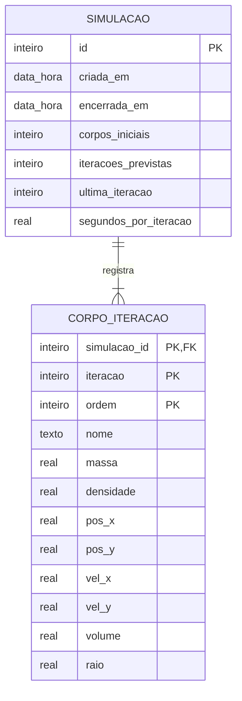

# Banco de Dados II — Simulador Gravitacional

## Modelo lógico

Uma simulação concluída registra um ou mais estados de corpos. Cada estado pertence a uma única simulação. A iteração 0 guarda o quadro inicial. A ordem começa em 0 em cada quadro e identifica a posição do corpo na lista daquele quadro. Quando dois corpos se fundem, os quadros seguintes só registram os corpos que existem após a fusão.

O aplicativo permite de 1 a 400 corpos iniciais. A última iteração gravada pode ser menor que a prevista se a janela for fechada antes do fim. As grandezas usam o SI: massa em kg, densidade em kg/m³, posição e raio em m, velocidade em m/s e volume em m³.

## Modelo relacional

| Relação | Atributos | Chaves |
|---|---|---|
| `simulacao` | id, criada_em, encerrada_em, corpos_iniciais, iteracoes_previstas, ultima_iteracao, segundos_por_iteracao | PK `(id)` |
| `corpo_iteracao` | simulacao_id, iteracao, ordem, nome, massa, densidade, pos_x, pos_y, vel_x, vel_y, volume, raio | PK `(simulacao_id, iteracao, ordem)`. FK `(simulacao_id)` → `simulacao(id)`. |

A chave composta garante uma única linha para cada posição da lista de corpos por quadro e simulação. O replay recupera o histórico na ordem de `iteracao` e `ordem`.

## Modelo físico

O banco `gravity_simulator` usa MySQL 8.4, InnoDB e `utf8mb4`.

| Tabela | Colunas | Tipo no MySQL |
|---|---|---|
| `simulacao` | `id` | `BIGINT AUTO_INCREMENT` |
| `simulacao` | `criada_em`, `encerrada_em` | `DATETIME(6)`. O encerramento aceita `NULL` durante a gravação. |
| `simulacao` | `corpos_iniciais`, `iteracoes_previstas`, `ultima_iteracao` | `INT` |
| `simulacao` | `segundos_por_iteracao` | `DOUBLE` |
| `corpo_iteracao` | `simulacao_id`, `iteracao`, `ordem`, `nome` | `BIGINT`, `INT`, `SMALLINT`, `VARCHAR(64)`, respectivamente. |
| `corpo_iteracao` | Massa, densidade, posição, velocidade, volume e raio | Oito colunas `DOUBLE`. |

- A chave primária de `corpo_iteracao` atende à leitura por simulação e à ordenação dos quadros no replay.
- O índice `idx_simulacao_encerrada (encerrada_em, id)` atende à listagem de simulações e à seleção das que venceram.
- A chave estrangeira usa `ON DELETE CASCADE`. O evento diário chama a procedure `excluir_simulacoes_antigas`, que exclui as simulações encerradas há mais de um mês e seus estados em lotes de até cinco simulações.

O DDL completo está no [script de criação do banco](criar_banco.sql).

## Estudo de volumetria

O enunciado prevê **50 simulações por dia** e **até 400 corpos por simulação**. Em 30 dias, a estimativa é de 1.500 registros na tabela `simulacao`. Para dimensionar `corpo_iteracao`, usamos 400 corpos em todos os quadros, inclusive o inicial. Fusões e encerramentos antecipados reduzem o volume real.

- Estados por simulação = `400 × (iterações + 1)`
- Estados por dia = `estados por simulação × 50`
- Espaço em 30 dias = `estados por dia × 30 × 160 bytes`

| Iterações por simulação | Estados por simulação | Estados por dia | Estados em 30 dias | Espaço em 30 dias |
|---:|---:|---:|---:|---:|
| 100 | 40.400 | 2.020.000 | 60.600.000 | 9,70 GB |
| 1.000 | 400.400 | 20.020.000 | 600.600.000 | 96,10 GB |

Os cenários de 100 e 1.000 iterações ilustram a variação de espaço conforme a duração. Os **160 bytes por estado** são uma hipótese de planejamento. Os tipos fixos somam 78 bytes por linha, sendo 64 bytes dos oito `DOUBLE` e 14 bytes dos campos da chave. O restante da estimativa cobre nome, metadados e ocupação de páginas do InnoDB. Os valores estão em GB decimais e referem-se à tabela de estados. Logs, backups e espaço temporário ficam fora da conta.

O estudo usa 30 dias como referência. A retenção do MySQL segue um mês de calendário, com execução diária, então o volume pode variar conforme o mês e o horário da limpeza.
